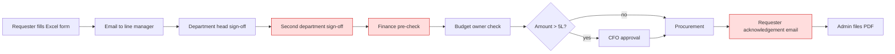

# As-Is Process (email & paper)

| Step | Touches | Avg wait (h) | Issue |
|---|---|---|---|
| Form + email | 2 | 4 | Wrong template, missing attachments (22% returned) |
| Line manager | 1 | 18 | Lost in inbox |
| Department head | 1 | 20 | |
| Second department sign-off | 1 | 16 | Duplicate of department head for cross-charged costs |
| Finance pre-check | 1 | 22 | Repeats budget owner check |
| Budget owner | 1 | 18 | |
| CFO (if > ₹5 L) | 1 | 30 | Travel, no delegation |
| Procurement + acknowledgement | 1 | 14 | Acknowledgement adds no control |
| Filing | — | 8 | Manual |
| **Total** | **9** | **~7 days** | No visibility of status |
