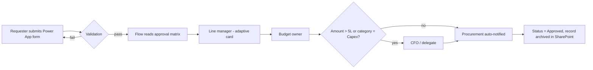

# To-Be Process (Power Platform)

**Removed:** second department sign-off (covered by cost-centre owner in matrix), finance pre-check (budget check now automated against budget list), acknowledgement email (status visible in app).

| Metric | As-is | To-be |
|---|---|---|
| Approval steps (max) | 7 | 4 |
| Manual touches | 9 | 2 (submit, approve) |
| Visibility | None | Live status, approver and SLA timer |
| Returned for missing info | 22% | < 3% (mandatory fields) |
